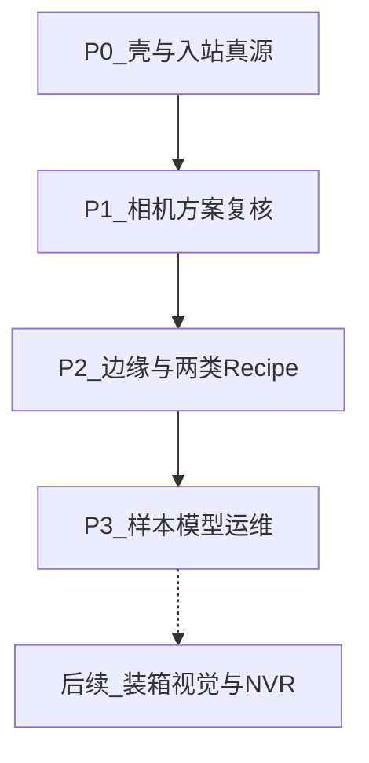
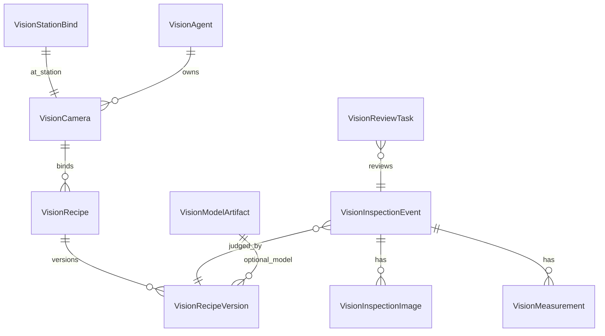

# 快视觉（kuaivision）建设路线图

> 专业 APP。仅视觉检测；不含安灯、模具防错、工控机部署、宿主强门禁。  
> 真源仓：`kuaigeyun-pro`；主仓经 `compose.py` 组装。  
> 对照日期：2026-10-16。


## 总原则

- **只做视觉检测**：方案、采集对接、判定结果、原图、复核。
- **不做**：安灯、模具防错、工控机采购部署、报价拆分、视觉 NG 阻断报工、全链路强改宿主。
- **复用平台**：权限/对象存储/时区/Pro License；边缘模式对齐 [kuaiiot ROADMAP](docs/apps/kuaiiot/ROADMAP.md)（token、config_version、心跳、幂等），**不**把视觉塞进 kuaiiot。
- **算法策略**：P0–P1 可先接第三方视觉机结果；自研/ONNX 推理在 P2 边缘落地，不以大模型阻塞首版。
- **页面规范（硬门禁）**：凡新建/补全 PC 页，写第一行 JSX 前必须读规范并抄同类型样板；**禁止**裸 ProTable、自写工具栏壳、漏 `showCreateButton`、在 `request` 写行缓存。



建议工期（1 后端 + 1 前端 + 0.5 边缘，可并行压缩）：

| 阶段 | 工期 | 可对外演示 |
|---|---|---|
| P0 | 2–3 周 | Postman/脚本上报 → PC 见记录与图 |
| P1 | 3–4 周 | 配相机与方案 → 复核 OK/NG |
| P2 | 4–6 周 | 单工位 Edge 跑厚度或步骤 POC |
| P3 | 2–3 周 | 样本/模型版本 + 稳定性验收 |

---

## 工程落点（立项后）

| 资产 | 路径 |
|---|---|
| Pro 后端 | `kuaigeyun-pro/backend/apps/kuaivision/` → compose 到 `riveredge-backend/src/apps/kuaivision` |
| Pro 前端 | `kuaigeyun-pro/frontend/apps/kuaivision/` → compose 到 `riveredge-frontend/src/apps/kuaivision` |
| 目录注册 | [`pro_app_catalog.py`](riveredge-backend/src/core/config/pro_app_catalog.py)、`proAppCatalog.ts`（sort **322**，紧随快数采） |
| 边缘 Agent | `kuaivision/edge-agent/`（独立进程，参考 `kuaiiot/edge-agent`） |
| 冒烟脚本 | `riveredge-backend/scripts/kuaivision_smoke_e2e.py` |
| 产品文档 | `docs/apps/kuaivision/ROADMAP.md` |

API 前缀：`/api/v1/apps/kuaivision/...`  
渠道头：沿用现有写防护（`X-Client-Channel`）；边缘入站用 **device token**，不走用户 JWT。

---

## PC 页面规范硬门禁（全阶段强制）

写页前必读（与 [new-pc-page-hard-gate](.cursor/memory/principles/new-pc-page-hard-gate.md) 一致）：

| 顺序 | 真源 | 用途 |
|---|---|---|
| 1 | [`.cursor/skills/new-document-page/SKILL.md`](.cursor/skills/new-document-page/SKILL.md) | 列表+弹窗+抽屉总清单；`showCreateButton`、权限 resource、工具栏 |
| 2 | [`.cursor/skills/unitable-list/SKILL.md`](.cursor/skills/unitable-list/SKILL.md) | 列宽/列序/徽章/新建文案「新建XXX」、`onTableDataChange` |
| 3 | [`.cursor/skills/form-modal/SKILL.md`](.cursor/skills/form-modal/SKILL.md) | 新建编辑弹窗：表头→明细→备注通栏→启用；有明细则 `grid={false}` |
| 4 | 详情选型 | **台账/方案/相机/Agent/样本** → [master-data-detail-drawer](.cursor/skills/master-data-detail-drawer/SKILL.md)（`STANDARD_WIDTH`、MarkerTag）；**检测记录** 若强调流程态可用业务抽屉契约，默认按主数据抽屉 + 测量/原图分区 |
| 5 | 视觉中心 | 对齐 [module-center](.cursor/skills/module-center/SKILL.md) 或现有 `kuaiiot` 仪表盘样板，禁止自造第三套首页 |
| 6 | i18n | 默认只改 `zh-CN.ts`；备注用 `common.remark`；交页跑 `scan_forbidden_i18n_keys.py` |

**抄样板（禁止平行发明）**

| 快视觉页面 | 页面类型 | 建议对照 |
|---|---|---|
| 检测记录 | 只读/弱编辑业务列表 + 详情 | 质量检验单列表或出入库流水类 UniTable；详情分区展示测量与原图 |
| 相机台账 | 主数据列表 + FormModal + 抽屉 | 设备台账 / 备件档案 |
| 视觉方案 / 版本 | 主数据 + 发布态 | SOP 或质检方案（含 publish） |
| 人工复核 | 待办型列表 + 抽屉内改判 | 质量异常 / 不良处理列表交互 |
| Agent 节点 | 主数据/运维列表 | kuaiiot 设备连接列表 |
| 样本库 / 模型制品 | 主数据列表 + 上传 | 附件或模型类既有页 |
| 视觉中心 | 指标卡 + 快捷入口 | kuaiiot 数采中心 / ModuleCenterLayout |

**UniTable 壳（缺任一项 = 该页未交付）**

- `permissionResource` = manifest 模块 resource（与后端码一致）
- 需要新建的台账/方案：`showCreateButton` + `createButtonText` =「新建XXX」+ `onCreate`（Modal 标题同步「新建XXX」/「编辑XXX」）
- 行缓存只写在 `onTableDataChange`，**禁止**在 `request` 内写 `tableRowsRef`
- 需要勾选批量则 `enableRowSelection`；操作列走 uni-action，不手写 icon/文案
- 状态/判定类：检测结果用 `MarkerTag` filled（非流程单据不要冒充右固定 `StatusTag lifecycle`，除非该页明确做成流程单）
- `columnPersistenceId` 改列后 bump；只改 `zh-CN`

**FormModal**

- 无明细：grid + colProps；备注倒数第二、启用最后
- 方案步骤清单等「行项目」：必须 `grid={false}`，表头 Row/Col，明细在表头外，备注在明细后
- 禁止裸 `Alert` 出格（用 `FormModalGridBlock`）

**每页交付自检（前端）**

- [ ] 已读 new-document-page 并对照上表样板
- [ ] 列表有权限门控；该有新建则「新建XXX」可见且可开弹窗
- [ ] 无 `request` 内写行缓存
- [ ] antd6 API（无 `destroyOnClose` / `message=` 等遗留）
- [ ] 用户可见能力写入平台更新日志（通用或 dedicated，按应用归属）

---

## 领域模型（全阶段共用）



| 表（建议前缀 `apps_kuaivision_`） | 职责 |
|---|---|
| `cameras` | 相机编码、品牌SDK类型、分辨率、工位绑定、启停 |
| `station_binds` | 相机 ↔ 厂区/车间/工位（只存 ID，主数据仍宿主） |
| `agents` | 边缘节点、device_token、last_heartbeat、config_version |
| `recipes` | 方案头：产品/工序可选关联、类型 `step_compliance` / `thickness_measure` |
| `recipe_versions` | 版本号、参数 JSON、状态 draft/published/obsolete、模型制品引用 |
| `inspection_events` | 一次检测：judgment、confidence、event_id 幂等、可选 wo/op/batch |
| `inspection_images` | 对象存储 key、角度/ROI 标签 |
| `measurements` | name/value/unit（如 thickness_mm） |
| `review_tasks` | 待复核、结论、复核人 |
| `model_artifacts` | 模型文件 key、框架 onnx、checksum、标签 |
| `sample_sets` / `sample_items` | P3：正负样本与标签 |

---

## P0 — 应用壳与入站真源（可验收：有记录）

**目标**：专业应用能装能开；外部用 token 上报一条检测，PC 能查到结果和原图。

### 交付清单

1. **注册**
   - manifest：`code=kuaivision`，`is_pro=true`，`market_category=pro`
   - 菜单：视觉中心（可先占位指标）、检测记录
   - 权限：`kuaivision:inspection:read|export`，`kuaivision:workspace:read`（中心）
   - License 范围挂 pro 目录；同步菜单脚本可单应用 sync

2. **库表 + 迁移**
   - 先落：`inspection_events` / `inspection_images` / `measurements` / `agents`（最小：token + 名称）
   - `event_id` 租户内唯一；业务时刻走 `resolve_business_datetime`

3. **API**
   - `POST /ingest/{device_token}`：单条上报（与 kuaiiot 入站路径对齐；写门禁豁免该前缀）
   - `POST /ingest/{device_token}/batch`：≤100 条续传
   - `GET /inspections` 列表 + `GET /inspections/{uuid}` 详情（含图 URL）
   - `GET|POST|PUT /agents` + `POST /agents/{uuid}/rotate-token`
   - 原图：先 `POST` 预签名或走现有附件上传，再在 ingest 里带 `image_refs`

4. **前端（必须走页面规范）**
   - 检测记录：UniTable 列表（时间、judgment、confidence、recipe、工位可选）+ 主数据型详情抽屉（测量表 + 原图）；`permissionResource` 对齐 inspection
   - 视觉中心：ModuleCenterLayout 指标 + 快捷入口
   - 边缘节点：UniTable + FormModalTemplate「新建边缘节点」+ 主数据抽屉 + 轮换 Token
   - 检测记录页无「新建检测」按钮（记录来自 ingest）；勿误开 `showCreateButton`

5. **冒烟**
   - `kuaivision_smoke_e2e.py`：持 device_token 入站 → 重复同 `event_id` 幂等 → 批量入站

**P0 落地状态（2026-10-16）**：目录注册（sort 322，数采之后）+ 迁移 `891` + Pro 前后端骨架 + 三页 + 冒烟脚本已落盘；需 `compose.py`、aerich upgrade、应用中心启用并 sync 菜单后联调。

### 入站 Payload（P0 冻结）

```json
{
  "event_id": "uuid-or-business-unique",
  "occurred_at": "2026-10-16 14:30:00",
  "judgment": "OK",
  "confidence": 0.96,
  "recipe_code": "THICKNESS_DEMO",
  "recipe_version": "1",
  "station_code": "WS-01",
  "camera_code": "CAM-01",
  "work_order_code": null,
  "operation_code": null,
  "batch_no": null,
  "measurements": [
    { "name": "thickness_mm", "value": 1.52, "unit": "mm" }
  ],
  "image_refs": ["s3-key-1"]
}
```

- `judgment` 仅 `OK` | `NG` | `UNKNOWN`
- 未知 recipe 允许先入库（P0），P1 起可配置「必须匹配已发布版本」

### P0 验收

| 项 | 标准 |
|---|---|
| 安装启用 | 应用中心专业 Tab 可见，License 开启后菜单出现 |
| 入站 | 合法 token 201；非法 token 401/403 |
| 幂等 | 同 `event_id` 第二次返回已存在，不新增行 |
| 列表 | 按时间倒序可见 judgment / 厚度值 |
| 原图 | 详情可打开至少 1 张图 |
| 时区 | API 墙钟串符合站点时区契约 |
| 页面规范 | UniTable 壳完整；无权限仍见按钮；抽屉单一 Template 不双树滑入 |

### P0 不做

Recipe 编辑器、相机 CRUD、复核、Edge 进程、宿主门禁。

---

## P1 — 相机、方案、复核、中心看板

**目标**：在 PC 上完成「配相机 → 发方案版本 → 看结果 → 纠偏」，仍可不接真实相机（用脚本模拟）。

### 交付清单

1. **相机与工位绑定**
   - CRUD `cameras`、`station_binds`
   - 字段：sdk_type（hik_mvs / basler_pylon / genicam / external_only）、序列号、备注
   - 菜单：相机与工位

2. **视觉方案**
   - `recipes` + `recipe_versions`
   - 类型枚举：`thickness_measure` | `step_compliance`
   - 版本状态机：draft → published（仅一版 published）→ obsolete
   - 参数 JSON Schema（P1 先文档约定，前端 Form 按类型分节）：
     - 厚度：`tol_min` / `tol_max` / `unit` / `channel`（laser|vision_2d|external）
     - 步骤：`steps[]`（name、roi 可选、required bool）、`fail_if_any_missing`
   - 菜单：视觉方案；发布需 `kuaivision:recipe:publish`

3. **入站增强**
   - 可选开关：仅接受 `published` 的 recipe_code+version
   - `confidence < recipe.review_threshold` → 自动建 `review_tasks`
   - `UNKNOWN` 默认进复核

4. **人工复核**
   - 列表：待复核 / 已复核
   - 动作：维持原判 / 改 OK / 改 NG + 原因；保留原 judgment 与复核后 judgment
   - 禁止删原图

5. **视觉中心**
   - 今日触发数、OK 率、待复核数、Agent 最后心跳（有则显示）
   - 布局：ModuleCenter 或 kuaiiot 看板样板

6. **页面规范落地（P1 各页）**
   - 相机：`showCreateButton`「新建相机」+ FormModal + 主数据抽屉；启用用 MarkerTag
   - 视觉方案：「新建方案」；版本发布走行操作/工具栏，文案与权限码一致；步骤行项目遵守 form-modal 明细竖序
   - 复核：列表待办筛选；改判在抽屉/弹窗内完成并留痕，不用裸 Modal 堆字段

### P1 验收

| 项 | 标准 |
|---|---|
| 方案发布 | 同 recipe 新发布自动作废旧 published |
| 阈值复核 | 低置信度自动出现在复核队列 |
| 复核审计 | 详情可见原判、复判、人、时间、原因 |
| 相机 | 停用相机仍保留历史事件可查 |
| 权限 | 无 publish 码不能发布；无 review 不能改判 |
| 新建文案 | 相机/方案工具栏与弹窗均为「新建XXX」，无裸「新建」 |
| 行缓存 | 相关列表无 `request` 内写 ref |

### P1 落地状态（2026-10-16）

**已完成**（迁移 `892`）：相机 / 方案版本发布 / 复核队列 / 入站 published 开关 / 中心待复核与心跳。联调前需 sync 菜单权限。

### P1 不做

真实采图、ONNX 推理、传感器驱动。

---

## P2 — Edge Agent + 厚度/步骤 POC 可跑通

**目标**：一台 IPC（或开发机）上的 Agent 拉配置、采图或读激光、出判定、上报；两类 Recipe 至少各完成一条现场或实验室 POC。

### 2.1 Edge Agent 工程

| 项 | 内容 |
|---|---|
| 包位置 | `kuaivision/edge-agent/` |
| 鉴权 | device_token（轮换 API 同 kuaiiot 思路） |
| 拉取 | `GET /agents/me/config` → cameras、published recipes、config_version |
| 心跳 | 周期上报在线、版本、磁盘、最近错误 |
| 本地队列 | SQLite/文件队列；断网续传 batch ingest |
| 运行模式 | `external_forward`（只转发第三方结果） / `local_pipeline`（本机采图+算法） |

### 2.2 采集适配（可插拔）

| 适配器 | P2 优先级 |
|---|---|
| `external_http` | P0：第三方视觉机推结果（已有） |
| `mock_camera` | 开发必达：读本地图片目录 |
| `hik_mvs` 或 `opencv_videocapture` | 选一做真实相机 POC |
| `laser_serial` / `laser_tcp` | 厚度首选通道 |

### 2.3 算法运行时

| Recipe 类型 | P2 落地路径 |
|---|---|
| `thickness_measure` | 读激光值 → 与 tol 比较 → judgment；可选拍一张定位图归档 |
| `step_compliance` | OpenCV 模板匹配 **或** ONNX 分类/检测（二选一先跑通）；步骤清单逐项 OK/NG |

模型文件：published 版本引用 `model_artifacts`；Agent 按 checksum 下载缓存。

### 2.4 PC 配套

- Agent 列表：在线、config_version、一键「使配置生效」（bump version）
- Recipe 绑定默认相机 / 默认触发：`manual` | `interval` | `gpio`（gpio 可先文档 + 软件模拟）
- 检测记录展示 Agent 与耗时 ms

### P2 验收（实验室即可）

| 项 | 标准 |
|---|---|
| 心跳 | 停 Agent 后中心显示离线（超时阈值可配，默认 60s） |
| 配置热更 | 发布新 Recipe 后 Agent 在下一拉取周期用新 version 判定 |
| 厚度 POC | 输入模拟 1.40 / 1.52 / 1.70，对应 NG/OK/NG，记录 measurements 正确 |
| 步骤 POC | 故意缺一步的样本图 → NG，并带 per-step 明细（存 measurements 或 JSON `step_results`） |
| 弱网 | 断网产生 ≥10 条，恢复后 batch 不丢、不重复 |
| 性能 | 单次 pipeline P95 &lt; 2s（不含人工放料；实验室 mock 图） |

### P2 落地状态（2026-10-16）

**已完成**（迁移 `893`）：Edge API（config/heartbeat）+ `edge-agent` 实验室进程（厚度/步骤 mock、SQLite 续传）+ Agent 在线/bump + 方案触发字段 + 检测记录节点/耗时 + 离线超时可配。联调：compose → aerich upgrade → 发布 interval 方案 → 填 token 启动 Agent。

### P2 不做

产线多工位大规模铺设、安灯联动、MES 开工拦截。

---

## P3 — 样本、模型治理与运维加固

**目标**：算法可迭代、现场可运维，达到「可复制到第二工位」的工程完成度。

### 交付清单

1. **样本库**
   - 按 Recipe 收集 OK/NG/边界样本；支持从检测记录「入库为样本」
   - 导出训练包（图片 + 标签 JSON），训练在仓外工具完成

2. **模型制品**
   - 上传 ONNX、checksum、输入尺寸、标签映射
   - Recipe 版本绑定模型；禁止 published 版本空引用（步骤类若声明需模型时）

3. **运维面**
   - Agent 磁盘/队列积压告警（站内消息模板可选）
   - 原图与事件保留天数策略（Taskiq 清理；默认图 90 天、事件 180 天可配）
   - 冒烟脚本扩展：config 拉取、心跳、batch

4. **文档**
   - 现场联调手册：相机、光源、激光接线、触发、曝光建议
   - 与商务报价无关的「推荐 IPC 规格」附录（可选，不写客户名）

### P3 验收

| 项 | 标准 |
|---|---|
| 样本闭环 | 记录 → 样本 → 导出包结构固定 |
| 模型切换 | 新版本发布后 Agent 下载新 onnx 再判定 |
| 清理 | 过期图不可访问，事件仍可按策略保留摘要 |
| 二工位 | 复制相机绑定 + 发布同 Recipe，第二 Agent 独立 token 跑通 |

### P3 落地状态（2026-10-16）

**已完成**（迁移 `895`）：样本集/条目 + 检测入库 + 导出 pack；模型制品 CRUD 与方案版本绑定/`require_model`；原图/事件保留策略 + Taskiq 日清；节点缓冲/磁盘运维告警（可配阈值 + 站内模板）；边缘 config 下发模型元数据；现场联调手册。联调：compose → aerich upgrade → sync 菜单权限 → 角色勾选 sample/model 码。

---

## 后续（路线图占位，不排期）

- 装箱条码/印章视觉、混装拦截（MES 缺项 §20）
- NVR/视频时间窗追溯（§21）
- 工位 HMI 结果条、NG 阻断报工、安灯、模具门禁（会后非视觉项）

---

## 技术栈（建设时选用约束）

| 层 | 选用 | 备注 |
|---|---|---|
| 云侧 | FastAPI + Tortoise + 对象存储连接器 | 与主仓一致 |
| 入站 | HTTPS JSON；可选 MQTT | token 鉴权 |
| 边缘 | Python 3.11+ Agent | 高帧率再评估 C++ |
| 采集 | GenICam / 厂商 SDK / OpenCV VideoCapture | 适配器模式 |
| 厚度 | **激光位移优先** | 纯 2D 测厚仅 POC |
| 传统 CV | OpenCV | 模板、ROI |
| DL | PyTorch 训练 → ONNX → ORT/TensorRT/OpenVINO | 步骤类 |
| 商用视觉 | Halcon/VM 等 | `external_forward`，不重写 |

---

## 风险与依赖

| 风险 | 应对 |
|---|---|
| 客户厚度精度未确认 | P2 先激光通道；方案参数可配公差 |
| 无工控机/相机到货 | P0–P1 全程脚本 + mock；不阻塞壳与真源 |
| 步骤「有误」定义模糊 | P1 Recipe 强制步骤清单；现场共创样本 |
| 与 kuaiiot 边界混淆 | 文档与目录隔离；禁止视觉帧进 TSDB |
| Pro 仓未开通 | P0 首要：compose + License 门禁打通 |

---

## 里程碑验收总表

| 里程碑 | 一句话 |
|---|---|
| M0 | 专业应用可装；脚本上报可见记录与图 |
| M1 | 可发布厚度/步骤方案；低置信度可复核 |
| M2 | 单节点 Edge 实验室跑通厚度或步骤之一，弱网不丢不重 |
| M3 | 样本/模型可切换；第二 Agent 可复制部署 |

---

## 确认执行后的落地顺序

1. 写 `docs/apps/kuaivision/ROADMAP.md`（本文压缩版，**含页面规范硬门禁与样板表**）
2. Pro 仓脚手架 + 目录注册（P0）
3. 每开一个前端页：先 Skill + 样板 → 再 API 联调；禁止先堆业务后补壳
4. 按 P0 → P1 → P2 → P3 逐段开发与冒烟，**每段完成再开下一段**
